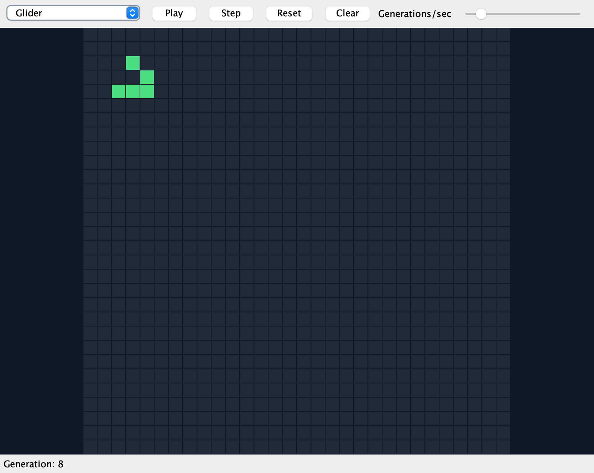
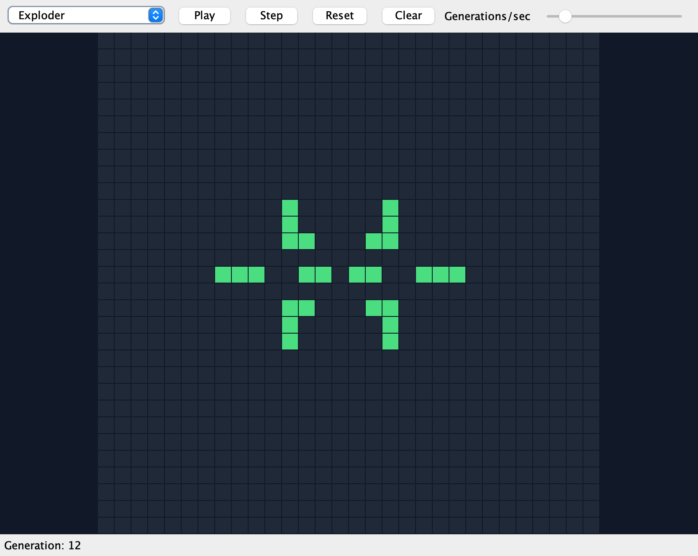
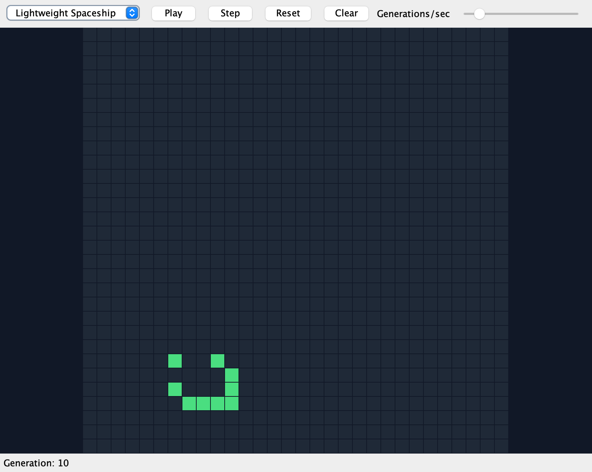

# Conway's Game of Life in Java

A Swing implementation of Conway's Game of Life on a 30×30 grid.

The "game" is a zero-player game, meaning that its evolution is determined by its initial state, requiring no further input. One interacts with the Game of Life by creating an initial configuration and observing how it evolves or, for advanced players, by creating patterns with particular properties.



## Rules

- Any live cell with fewer than two live neighbours dies, as if caused by under-population.
- Any live cell with two or three live neighbours lives on to the next generation.
- Any live cell with more than three live neighbours dies, as if by overcrowding.
- Any dead cell with exactly three live neighbours becomes a live cell, as if by reproduction.

The grid has fixed edges: cells beyond the border count as dead, and patterns do not wrap around.

## How to run

Requires JDK 8 or newer.

```
javac -d out src/*.java
java -cp out GameOfLife
```

## Using the app

- **Pattern picker**: load a preset (10 Cell Input, Glider, Exploder, Blinker, Lightweight Spaceship).
- **Play / Pause**: run the simulation continuously.
- **Step**: pause and advance a single generation.
- **Reset**: reload the selected pattern.
- **Clear**: empty the grid.
- **Click a cell** to toggle it, so you can draw your own patterns.
- **Generations/sec** slider: set the speed from 1 to 30 generations per second.

The current generation is shown in the status bar at the bottom.

## Screenshots

| Exploder | Lightweight Spaceship |
|---|---|
|  |  |

## Code layout

| File | Responsibility |
|---|---|
| `src/GameOfLife.java` | Entry point, window and controls |
| `src/Life.java` | Simulation: grid state and generation step, no UI |
| `src/LifePanel.java` | Draws the grid and maps clicks to cells |
| `src/Pattern.java` | Preset starting patterns |
